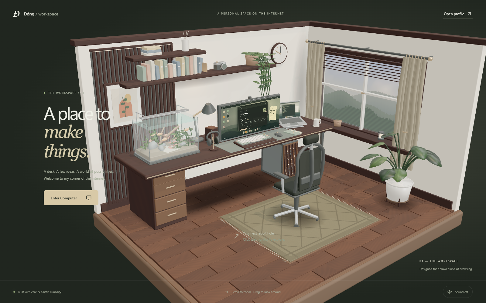
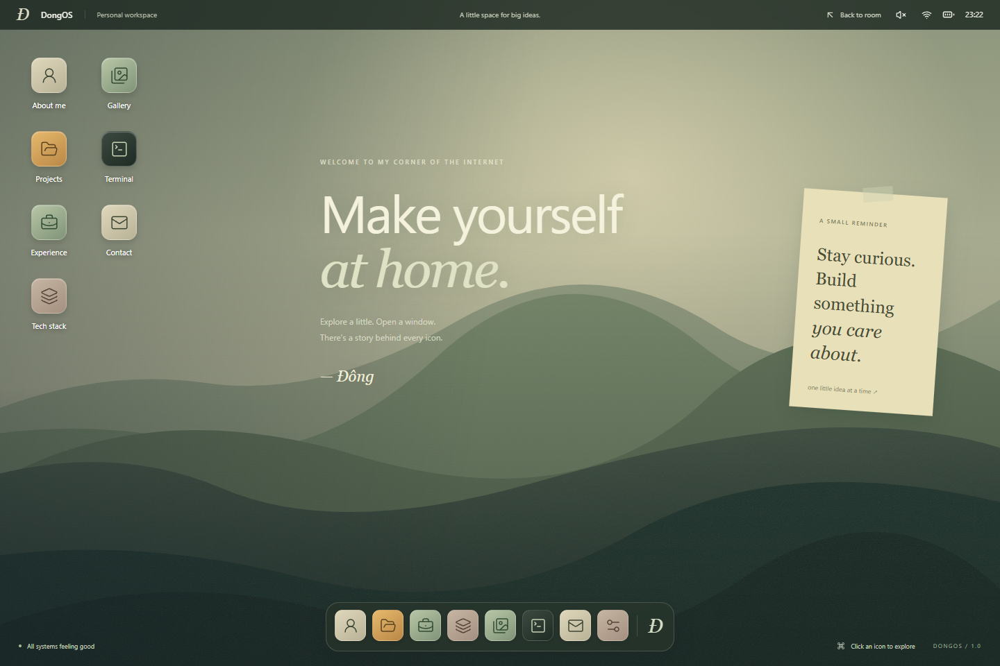
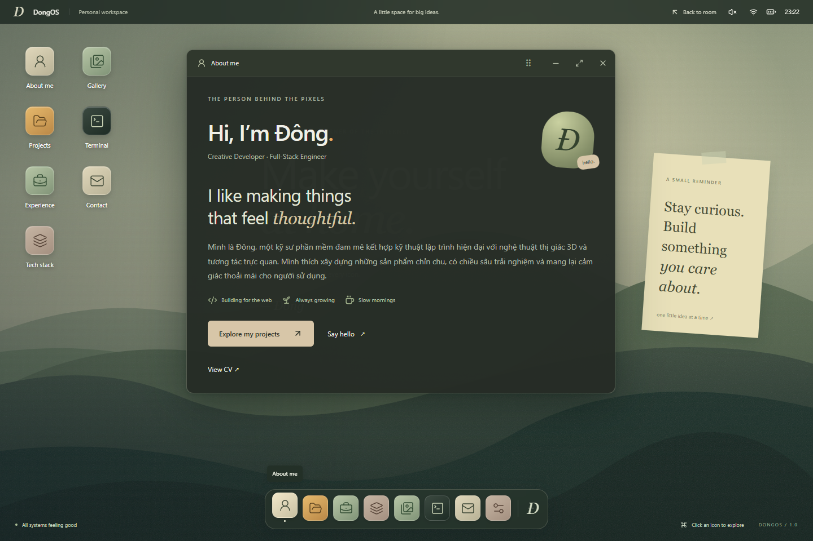
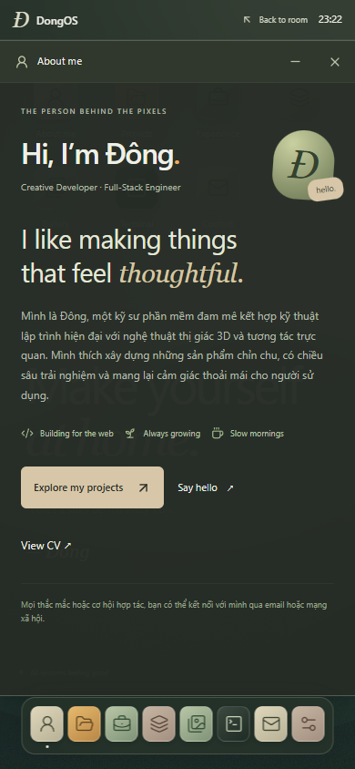

# Personal 3D Workspace OS (DongOS)

> **Interactive 3D Workspace → Zoom into the monitor → Use apps in the room**

Dự án website portfolio cá nhân tương tác lấy cảm hứng từ không gian làm việc ấm cúng (Cozy Mature Isometric Diorama) kết hợp với một hệ điều hành giả lập (**DongOS**) ngay trên trình duyệt.

---

## ✨ Tính năng nổi bật

- **Căn phòng 3D chân thực (Three.js / React Three Fiber / Blender)**:
  - Thiết kế góc nhìn Isometric Cutaway với chất liệu gỗ Walnut, Olive, Sand và ánh nắng chiều ấm áp.
  - Chi tiết sống động: Bể cá thủy sinh bên trái bàn, thùng PC kính dưới gầm bàn với quạt LED quay, màn hình ultrawide, laptop, ghế công thái học, kệ sách và cây dây leo.
- **Zoom và thao tác trực tiếp trên màn hình**:
  - Cuộn chuột hoặc pinch để zoom vào màn hình và sử dụng app ngay trong cảnh 3D, không chuyển sang trang OS. Màn hình dùng cùng một giao diện sống ở cả góc nhìn ngoài và khi zoom vào, giữ nguyên nội dung và cửa sổ; chỉ bật tương tác khi zoom sát. Đèn ScreenBar luôn hiển thị với mặt tán sáng màu trắng, không phát sáng hoặc chiếu ánh sáng xuống bàn. Cuộn trong cửa sổ chỉ cuộn nội dung; nút Back to room đưa camera về phòng.
- **Hệ điều hành Desktop giả lập (DongOS)**:
  - Quản lý đa cửa sổ với **Zustand**: Kéo thả (drag), thu nhỏ (minimize), phóng to (maximize), đóng (close), tự động sắp xếp thứ tự lớp (`z-index`) và giữ cửa sổ luôn trong khung nhìn khi đổi kích thước màn hình.
  - **8 Ứng dụng tích hợp**:
    1. **About me**: Giới thiệu bản thân, sở thích, liên kết CV.
    2. **Projects**: Danh sách dự án lọc theo danh mục (Website, CRM, AI, Game, Experiments) và tìm kiếm từ khóa theo thời gian thực.
    3. **Experience**: Timeline quá trình làm việc và các thành tựu nổi bật.
    4. **Tech stack**: Các nhóm kỹ năng công nghệ được phân loại trực quan.
    5. **Gallery**: Bộ sưu tập hình ảnh kèm chế độ xem phóng to (Lightbox).
    6. **Terminal**: Dòng lệnh tương tác hỗ trợ gõ lệnh (`help`, `about`, `projects`, `skills`, `contact`, `clear`) và phím mũi tên duyệt lịch sử lệnh.
    7. **Contact**: Sao chép nhanh địa chỉ email và liên kết mạng xã hội.
    8. **Settings**: Bật/tắt âm thanh giao diện (Web Audio synth), chế độ giảm chuyển động (`Reduce motion`), và đổi hình nền Desktop.
- **Truy cập trực tiếp & Khả năng tương thích cao**:
  - Đường dẫn trực tiếp `/os` mở ngay giao diện Desktop thuần DOM mà **không cần tải mô hình 3D hay WebGL**, đảm bảo tốc độ tức thì trên mọi thiết bị.
  - Tự động hiển thị giao diện fallback thân thiện nếu trình duyệt không hỗ trợ WebGL2.
  - Tối ưu hiển thị full-screen gọn gàng trên thiết bị di động.

---

## 📸 Hình ảnh giao diện

| Không gian 3D (` / `) | Màn hình Desktop (` /os `) |
| :---: | :---: |
|  |  |

| Ứng dụng About Me | Giao diện Mobile Responsive |
| :---: | :---: |
|  |  |

---

## 🛠 Công nghệ sử dụng

- **Framework**: Next.js 16 (App Router, Static Export) + React 19 + TypeScript
- **Styling**: Tailwind CSS v4 + Custom CSS Variables
- **3D & Animation**: Three.js, `@react-three/fiber`, `@react-three/drei`
- **State Management**: Zustand
- **Icons**: Lucide React
- **3D Authoring**: Blender (`.blend` + Python procedural generation script)
- **Testing**: Vitest (Unit tests) + Playwright (End-to-End browser tests)

---

## 🚀 Hướng dẫn cài đặt & Chạy dự án

### 1. Cài đặt dependencies
```bash
npm install
```

### 2. Chạy môi trường phát triển (Development)
```bash
npm run dev
```
Truy cập:
- Trải nghiệm 3D đầy đủ: [http://127.0.0.1:3000](http://127.0.0.1:3000)
- Truy cập thẳng hệ điều hành DongOS: [http://127.0.0.1:3000/os](http://127.0.0.1:3000/os)

### 3. Kiểm tra kiểu dữ liệu & Chạy kiểm thử (Tests)
```bash
# Kiểm tra TypeScript
npm run typecheck

# Chạy Unit Tests (Vitest)
npm run test

# Chạy End-to-End Tests (Playwright - cần bật server ở cổng 3000)
npm run test:e2e
```

### 4. Build bản Production (Static Export)
```bash
npm run build
```
Sau khi chạy lệnh trên, toàn bộ website tĩnh sẽ được xuất ra tại thư mục `out/`, sẵn sàng để host trên bất kỳ nền tảng static hosting nào (Vercel, Netlify, Cloudflare Pages, GitHub Pages, S3...).

---

## ✏️ Hướng dẫn chỉnh sửa nội dung cá nhân

Toàn bộ dữ liệu hiển thị trong các ứng dụng của **DongOS** được tách biệt hoàn toàn tại thư mục `src/data/`:

- **`src/data/profile.ts`**: Chỉnh sửa tên, chức danh, câu giới thiệu (`bio`), địa chỉ email, link CV và các liên kết mạng xã hội (GitHub, LinkedIn, X...).
- **`src/data/projects.ts`**: Thêm, sửa hoặc xóa các dự án trong portfolio (mô tả, công nghệ sử dụng, vai trò, tính năng chính, link live demo và source code).
- **`src/data/experience.ts`**: Cập nhật lịch sử làm việc, tên công ty, khoảng thời gian và các thành tựu đạt được.
- **`src/data/skills.ts`**: Cập nhật danh sách kỹ năng và công cụ theo từng nhóm chuyên môn.
- **`public/images/`**: Thay thế hình ảnh trong ứng dụng Gallery hoặc hình nền.

---

## 🎨 Tái tạo mô hình 3D từ Blender (Tùy chọn)

File nguồn 3D và script dựng phòng tự động được lưu trong thư mục `blender/`:
- `blender/build_room.py`: Script Python tạo toàn bộ kiến trúc phòng, nội thất, vật liệu, ánh sáng và xuất ra file `.blend` cùng `.glb`.
- `blender/room.blend`: File nguồn Blender.
- `public/models/room.glb`: File mô hình 3D được load trực tiếp trên web.

Để chạy lại script xuất model mới từ Blender CLI:
```bash
blender -b -P blender/build_room.py
```

