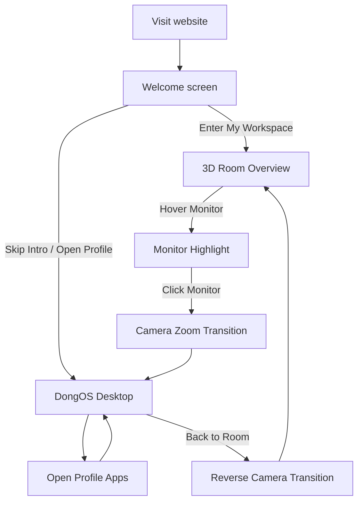
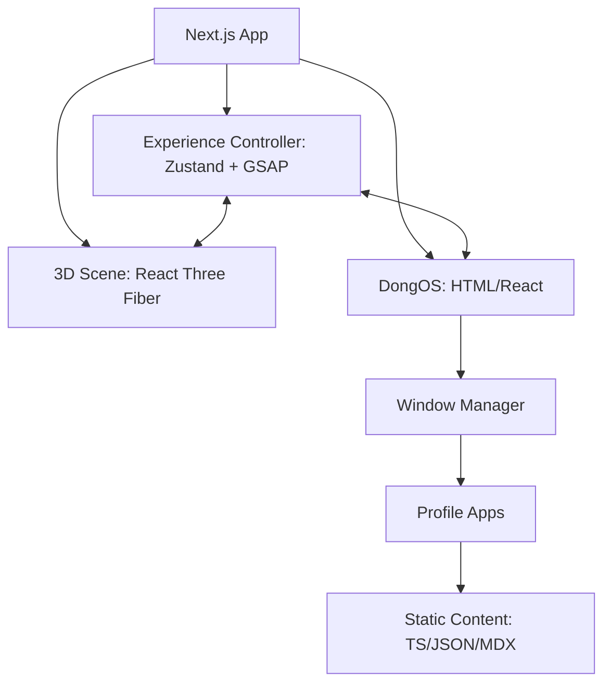

# PERSONAL 3D WORKSPACE OS

> Tài liệu đặc tả sản phẩm và kỹ thuật (MVP)  
> Phiên bản: 2.0 — 08/11/2026 (chốt công nghệ và thứ tự triển khai)  
> Tên dự án tạm: **Personal 3D Workspace OS**  
> Tên desktop OS tạm: **DongOS**

## 1. Tổng quan

Xây dựng website profile cá nhân tương tác theo hướng **3D Isometric Cutaway Workspace → Computer → Desktop OS**, lấy cảm hứng từ trải nghiệm website [henryheffernan.com](https://henryheffernan.com/) nhưng có thiết kế riêng.

Người dùng vào một căn phòng làm việc 3D chân thực, click vào màn hình máy tính, camera zoom mượt vào màn hình rồi chuyển sang một hệ điều hành giả lập. Toàn bộ nội dung profile, dự án, kinh nghiệm và liên hệ hiển thị dưới dạng các ứng dụng/cửa sổ trong hệ điều hành.

### Mục tiêu
- Tạo trải nghiệm profile cá nhân đặc sắc, thể hiện khả năng làm web và sản phẩm tương tác.
- Dùng căn phòng 3D như màn hình mở đầu, không phải game điều khiển nhân vật.
- Dùng desktop OS làm nơi chứa nội dung, cập nhật dễ dàng.
- Trải nghiệm mượt, responsive và có chế độ truy cập trực tiếp OS.

### Phạm vi đã chốt
- **Phương án A**: Căn phòng 3D → click monitor → vào OS giả lập.
- Model căn phòng **3D thật**, không dùng ảnh 2D cố định để giả làm phòng tương tác.
- Phong cách **realistic/stylized-realistic trưởng thành**, không cute/toy-like.
- Giữ bàn, ghế công thái học, monitor, laptop, bàn phím, chuột, **bể cá cảnh**, **thùng PC dưới bàn**, kệ sách, cây leo, cửa sổ.
- **Không có giường, máy phát đĩa, ghế đôn, ván trượt** từ concept ban đầu.
- Nội dung web là profile cá nhân, không có CMS/backend trong MVP.

## 2. Art direction

### Phong cách
- Isometric Cutaway Room / Diorama Architecture.
- Mature Cozy Workspace, realistic textures, natural proportions.
- Góc nhìn chéo từ trên xuống, phối cảnh nhẹ; 2 mặt phòng được mở để nhìn vào bên trong.
- Gỗ tối, cây xanh, vật liệu vải/kim loại/kính chân thực; ánh nắng chiều ấm.
- Bo góc vừa phải, tránh phong cách hoạt hình.

### Màu chủ đạo
| Tên | HEX | Vai trò |
|---|---|---|
| Walnut | `#30231B` | Gỗ, kết cấu chính |
| Olive | `#5E654B` | Cây, accent |
| Sand | `#D7C6A8` | Tường, vải, nền |
| Amber | `#E8AD63` | Đèn, LED, điểm nhấn |
| Charcoal | `#1C211E` | Desktop, text trên nền sáng tương ứng |

### Ánh sáng
- Sunlight từ cửa sổ tạo bóng đổ tự nhiên.
- LED thanh dưới kệ và đèn bàn màu vàng ấm.
- Quạt PC ánh sáng amber rất nhẹ.
- Bể cá có nguồn sáng riêng, nước trong và phản xạ tinh tế.
- Baked lighting ưu tiên cho cảnh tĩnh; các nguồn sáng động dùng hạn chế.

## 3. Danh sách vật thể trong căn phòng

| Nhóm | Vật thể | Yêu cầu |
|---|---|---|
| Kiến trúc | Sàn gỗ, 2 tường góc, viền trên, cửa sổ, rèm | Cutaway rõ, góc nhìn isometric |
| Bàn làm việc | Bàn gỗ rộng, hộc tủ | Kích thước hợp lý, chừa không gian chân |
| Thiết bị | Monitor ultrawide, laptop, bàn phím, chuột, pad, tai nghe | Monitor là đối tượng click chính |
| Ghế | Ghế công thái học lưng lưới, tựa đầu | Thiết kế hiện đại, tỷ lệ thật |
| PC | Case kính đặt **dưới bàn**, quạt LED amber | Tách quạt để animate quay |
| Aquarium | Bể cá thủy sinh **trên bàn, bên trái** | Có cá bơi, cây thủy sinh và mặt nước |
| Cây xanh | Pothos/cây leo thả từ kệ; một chậu cây sàn | Không che monitor hoặc lối nhìn |
| Decor | Sách, máy ảnh, khung tranh, đồng hồ, đèn | Tiết chế, không quá đông |
| Sàn | Thảm dệt dưới ghế | Giữ không gian thông thoáng |

### Quy tắc bố trí
- Monitor và laptop cùng nằm trên bàn; monitor ở trung tâm vùng làm việc.
- Bể cá ở một đầu bàn, tách khỏi ổ điện và PC trong bố trí thực tế.
- Thùng PC nằm ở khoang dưới bàn, không chắn chân ghế.
- Kệ sách và dây leo ở phía trên/lưng bàn.
- Cửa sổ ở tường bên phải; vùng trước bàn thông thoáng.
- Không thêm giường, ván trượt, máy phát đĩa hoặc ghế đôn.

## 4. User journey



### 4.1 Welcome
- Nền tối ấm; tên và tagline ngắn.
- CTA chính: **Enter My Workspace**.
- CTA phụ: **Open Profile Directly** để bỏ qua 3D.
- Có loading progress khi tải model; tránh giữ người dùng trong màn hình chờ không cần thiết.

### 4.2 Room overview
- Camera ở vị trí isometric mặc định, căn phòng trong khung hình.
- Idle: quạt PC quay, cá bơi, cây chuyển động nhẹ, màn hình sáng, nắng ổn định.
- Mouse movement có thể tạo parallax rất nhỏ.
- Monitor có affordance rõ ràng: hover cursor, glow hoặc nhãn `Enter Computer`.
- Có nút `Enter Computer` độc lập để hỗ trợ keyboard/touch.

### 4.3 Monitor zoom
1. Người dùng click monitor hoặc nút Enter Computer.
2. Khoá tương tác camera trong lúc transition.
3. GSAP di chuyển camera tới điểm nhìn thẳng trên monitor.
4. Khi vùng monitor gần phủ toàn viewport, crossfade sang desktop HTML.
5. Focus chuyển vào Desktop OS; cập nhật URL/state hỗ trợ Back.

> Desktop OS là UI React/HTML thật, không phải một website render liên tục lên texture của màn hình 3D. Khi nhìn từ phòng có thể dùng preview tĩnh/texture của desktop để tối ưu hiệu năng.

### 4.4 Back to Room
- Nút `Back to Room` trong OS.
- OS thu nhỏ/crossfade vào màn hình giả lập và camera chạy ngược.
- Giữ trạng thái các ứng dụng đã mở khi quay lại OS trong cùng phiên.

## 5. Giao diện DongOS

### Desktop
- Wallpaper tông olive/charcoal kết hợp ảnh thiên nhiên nhẹ.
- Desktop icons có nhãn dễ đọc.
- Taskbar/dock ghim ứng dụng quan trọng.
- Top bar hiển thị tên OS, trạng thái và nút Back to Room.
- Có phân biệt active/inactive window, hover/focus rõ ràng.

### Window Manager
- Open / focus / minimize / maximize / close.
- Desktop: kéo cửa sổ, sắp xếp nhiều cửa sổ.
- Z-index theo cửa sổ đang focus.
- Giới hạn vị trí để cửa sổ không bị kéo hoàn toàn ra ngoài vùng nhìn.
- Chỉ một phiên bản cho mỗi app ở MVP; mở lại app đã có sẽ focus window.
- Phím Escape/keyboard behavior được xác định rõ; không tự đóng toàn bộ OS.
- Trên mobile: app hiển thị một cửa sổ full-screen hoặc full-width, không ép drag nhiều cửa sổ.

### Danh sách ứng dụng

#### 5.1 About Me
- Ảnh, tagline, mô tả bản thân.
- Cách làm việc, định hướng, sở thích.
- Link tải/xem CV nếu có file chính thức.

#### 5.2 Projects Explorer
- Bộ lọc: Website, CRM, AI, Game, Experiments.
- Grid/list dự án từ dữ liệu tĩnh.
- Mỗi project: tên, thumbnail, mô tả, vai trò, tech stack, tính năng, demo, repository nếu public.
- Click project mở cửa sổ chi tiết trong OS.

#### 5.3 Experience
- Timeline quá trình làm việc.
- Vai trò, tổ chức, thời gian, thành tựu.
- Không tự tạo thông tin khi chưa có dữ liệu xác nhận.

#### 5.4 Tech Stack
- Nhóm Frontend, Backend, Database, DevOps, 3D, AI/Automation.
- Biểu diễn bằng icon + mô tả khả năng thực tế, không dùng progress bar phần trăm tùy tiện.

#### 5.5 Gallery
- Ảnh, sở thích nhiếp ảnh, dự án ngoài lập trình nếu muốn.
- Grid hình và lightbox.

#### 5.6 Terminal
- Command-line UI giả lập, không chạy lệnh shell thật.
- Lệnh MVP: `help`, `about`, `skills`, `projects`, `contact`, `clear`.
- Link/nút dựa trên route nội bộ, không eval input.

#### 5.7 Contact
- Email (mailto/copy), mạng xã hội, liên kết ngoài.
- Có thể thêm CTA hợp tác/dự án.
- Form gửi trực tiếp **ngoài phạm vi MVP** trừ khi sau này tích hợp dịch vụ gửi form.

#### 5.8 Settings
- Sound on/off.
- Reduce motion và graphic quality (nếu cần).
- Theme sáng/tối cho OS có thể đưa vào giai đoạn sau; MVP giữ một theme thống nhất.

## 6. Animation specification

| Tương tác | Animation | Thời lượng gợi ý |
|---|---|---|
| Enter | Overlay fade + camera dolly | 0.8–1.2s |
| Hover Monitor | Viền sáng + cursor | 0.15–0.25s |
| Click Monitor | Camera path đến mặt màn hình | 0.9–1.4s |
| 3D → OS | Crossfade tại thời điểm monitor phủ viewport | 0.2–0.35s |
| Window open | Scale 0.96 → 1 + fade | 0.18–0.28s |
| Minimize | Scale/translate về taskbar | 0.18–0.25s |
| Close | Scale nhỏ + fade | 0.12–0.2s |
| Back to Room | Transition ngược | 0.9–1.4s |

Các giá trị là điểm khởi đầu để tuning, không phải yêu cầu cố định. Respect `prefers-reduced-motion`.

## 7. Stack kỹ thuật (ĐÃ CHỐT)

| Hạng mục | Công nghệ |
|---|---|
| Framework | Next.js App Router, TypeScript |
| UI | React + Tailwind CSS |
| 3D runtime | Three.js, React Three Fiber, Drei |
| 3D authoring | Blender |
| Model format | GLB/GLTF |
| Animation | GSAP cho camera/transition; React/CSS cho window UI; useFrame cho animation 3D nhẹ |
| State | Zustand (experience state, window manager) |
| Content | TypeScript/JSON/MDX tĩnh |
| Deploy | Vercel hoặc Cloudflare Pages (kiểm tra tương thích với chế độ deploy chọn) |

**Không yêu cầu NestJS, database, CMS, đăng nhập hay API riêng trong MVP.**


### 7.1 Quyết định triển khai
- **Chọn Next.js thay vì Vite** vì muốn profile có URL, metadata/SEO, deep links và thuận tiện mở rộng nội dung. Vite vẫn là lựa chọn hợp lệ nếu chỉ cần SPA, nhưng không dùng trong dự án này.
- **Dùng Blender để dựng môi trường 3D**; xuất `.glb` rồi import qua React Three Fiber. Không dựng toàn bộ nội thất bằng primitive code, chỉ dùng khối tạm ở giai đoạn prototype.
- **Desktop OS là React/HTML thật**, không render giao diện hoàn chỉnh thành texture Three.js. Monitor trong phòng dùng ảnh preview; khi zoom gần đầy khung hình sẽ crossfade sang UI thật.
- **Không backend ở MVP**. Nội dung các app được quản lý bằng file `src/data/*.ts` hoặc MDX; Contact dùng `mailto:` hoặc liên kết ngoài.
- Dùng **GSAP** để điều khiển timeline camera và transition; **Zustand** làm state chung; `useFrame` chỉ dùng animation môi trường nhẹ.

### 7.2 Các package chính
```bash
npx create-next-app@latest personal-workspace --typescript --tailwind --eslint --app --src-dir
cd personal-workspace
npm install three @react-three/fiber @react-three/drei gsap zustand
npm install -D @types/three
```
Không khóa version trong đặc tả; khi khởi tạo dự án cần chọn phiên bản tương thích và kiểm thử build.

### 7.3 Quy tắc Next.js và 3D
- Canvas và những thành phần phụ thuộc WebGL phải chạy phía client (`'use client'`) và có thể lazy-load.
- Bổ sung loading screen/progress cho model; có fallback `Enter Desktop` khi WebGL không khả dụng.
- Các trang nội dung OS phải có tiêu đề, liên kết và text thật để không bị khóa toàn bộ profile trong canvas 3D.
- Nếu xuất static, tránh dùng tính năng yêu cầu Node server; xác nhận tương thích hosting trước khi deploy.

## 8. Kiến trúc hệ thống



### State cốt lõi
```ts
type ExperienceMode = 'welcome' | 'room' | 'entering-os' | 'os' | 'leaving-os';

type WindowState = {
  id: string;
  appId: string;
  isOpen: boolean;
  minimized: boolean;
  maximized: boolean;
  zIndex: number;
  position: { x: number; y: number };
  size: { width: number; height: number };
};
```

### URL
- `/`: Welcome + 3D Room.
- `/os`: Direct-access Desktop OS (bỏ qua intro / fallback).
- Có thể dùng query hoặc state để mở trực tiếp ứng dụng về sau, ví dụ `/os?app=projects`.
- Deep links phải hoạt động khi refresh.

### Quy tắc chuyển trạng thái
- `entering-os` và `leaving-os` phải chống click lặp.
- Khóa/unlock controls đúng thời điểm.
- Nếu chưa tải được 3D hoặc WebGL lỗi, có CTA `Open Profile` dẫn tới `/os`.
- State OS tồn tại trong client session khi quay lại phòng, không bắt buộc persist lâu dài.

## 9. Cấu trúc repo

```text
personal-workspace/
├── public/
│   ├── models/
│   │   ├── room.glb
│   │   ├── aquarium.glb
│   │   └── pc.glb
│   ├── textures/
│   ├── images/
│   ├── audio/
│   └── fonts/
├── blender/
│   └── room.blend
├── src/
│   ├── app/
│   │   ├── page.tsx
│   │   ├── os/page.tsx
│   │   ├── layout.tsx
│   │   └── globals.css
│   ├── components/
│   │   ├── scene/
│   │   │   ├── RoomScene.tsx
│   │   │   ├── RoomModel.tsx
│   │   │   ├── CameraController.tsx
│   │   │   ├── Monitor.tsx
│   │   │   ├── Aquarium.tsx
│   │   │   └── Lighting.tsx
│   │   ├── os/
│   │   │   ├── Desktop.tsx
│   │   │   ├── Taskbar.tsx
│   │   │   ├── DesktopIcon.tsx
│   │   │   ├── WindowManager.tsx
│   │   │   └── WindowFrame.tsx
│   │   └── apps/
│   │       ├── AboutApp.tsx
│   │       ├── ProjectsApp.tsx
│   │       ├── ExperienceApp.tsx
│   │       ├── SkillsApp.tsx
│   │       ├── GalleryApp.tsx
│   │       ├── TerminalApp.tsx
│   │       └── ContactApp.tsx
│   ├── stores/
│   │   ├── experienceStore.ts
│   │   └── windowStore.ts
│   ├── data/
│   │   ├── profile.ts
│   │   ├── projects.ts
│   │   ├── skills.ts
│   │   └── experience.ts
│   ├── hooks/
│   ├── lib/
│   └── types/
├── docs/
│   ├── design.md
│   ├── interactions.md
│   └── architecture.md
├── README.md
└── package.json
```

## 10. Responsive

### Desktop
- Full 3D room.
- Mouse hover, click, camera zoom.
- OS hỗ trợ đa cửa sổ, kéo, minimize/maximize.

### Tablet
- 3D tùy khả năng thiết bị, có thể giảm chất lượng.
- Tăng kích thước target thao tác.
- OS tập trung vào một hoặc ít cửa sổ lớn.

### Mobile
- Phòng 3D bản nhẹ hoặc ảnh preview tĩnh nếu tài nguyên hạn chế.
- CTA rõ: `Enter Computer`.
- OS dùng app view full-screen, navigation như mobile desktop, không ép kéo thả.

### Accessibility
- Điều hướng bàn phím cho CTA và các app.
- Contrast đủ tốt, focus styles rõ.
- Reduce motion.
- Tắt âm thanh mặc định nếu cần; bật qua tương tác của người dùng.
- Bản `/os` có thể truy cập trực tiếp không cần WebGL.

## 11. Tối ưu hiệu năng

- Dùng model GLB đã tối ưu mesh và texture.
- Texture nén (KTX2/Basis nếu phù hợp), geometry compression (Draco/Meshopt).
- Baked lightmaps/lighting cho phần tĩnh.
- Giảm draw calls, hợp nhất vật thể tĩnh khi không làm mất khả năng tương tác.
- Animation cá bằng đường bơi đơn giản; không mô phỏng chất lỏng thật.
- Tránh postprocessing nặng, shadows quá nhiều và đèn động thừa.
- Lazy-load OS hoặc model tùy điểm vào.
- Kiểm tra FPS, memory, thời gian tải trên thiết bị thật.

## 12. MVP roadmap

### Phase 1 — Room 3D
- [ ] Dựng kiến trúc cutaway trong Blender.
- [ ] Dựng bàn, monitor, laptop, chuột, bàn phím, ghế công thái học.
- [ ] Thêm thùng PC dưới bàn, bể cá bên trái bàn.
- [ ] Kệ sách, dây leo, cửa sổ, rèm, sàn, thảm.
- [ ] Material/lighting gần thực tế; xuất `.glb`.
- [ ] Load scene trong Next.js + React Three Fiber.

### Phase 2 — Room interaction
- [ ] Welcome + Enter + Skip.
- [ ] Monitor hitbox và hover affordance.
- [ ] GSAP zoom camera vào monitor.
- [ ] Crossfade đúng điểm sang HTML desktop.
- [ ] Back to Room và xử lý click lặp.

### Phase 3 — DongOS
- [ ] Desktop wallpaper, icon, taskbar.
- [ ] Window manager: open/focus/drag/minimize/maximize/close.
- [ ] About, Projects, Experience, Skills.
- [ ] Gallery, Contact, Terminal cơ bản.
- [ ] Data project/profile có thể sửa từ file tĩnh.

### Phase 4 — Polish & launch
- [ ] Cá bơi, LED/quạt PC, dây leo, ánh sáng tinh tế.
- [ ] Mobile UX, tablet UX.
- [ ] Loading/progress/error/fallback.
- [ ] Accessibility + reduce motion.
- [ ] SEO metadata/Open Graph và deploy.
- [ ] Kiểm thử hiệu năng trên desktop/mobile.

## 13. Acceptance criteria MVP

1. Người dùng có thể vào trang `/`, nhìn thấy căn phòng 3D với đủ các vật thể đã chốt.
2. Không còn giường, ván trượt, máy phát đĩa và ghế đôn.
3. **Bể cá cảnh** hiển thị rõ trên bàn; **thùng PC** ở dưới bàn.
4. Click monitor chuyển camera mượt sang desktop OS.
5. Desktop OS có app, taskbar, hệ thống cửa sổ hoạt động trên desktop.
6. Các mục About, Projects, Experience, Skills, Contact có nội dung thật hoặc placeholder được đánh dấu rõ để thay thế.
7. Nút Back to Room hoạt động mà không reload bắt buộc.
8. Truy cập `/os` trực tiếp được, kể cả khi không chạy được 3D.
9. Mobile dùng được và không phụ thuộc hover/drag.
10. Không bắt buộc backend, database hoặc CMS.

## 14. Tham khảo

- Website trải nghiệm: https://henryheffernan.com/
- Repo tham khảo 3D: https://github.com/henryjeff/portfolio-website
- Repo tham khảo OS: https://github.com/henryjeff/portfolio-inner-site

> Tài liệu này chốt hướng xây dựng, không yêu cầu sao chép code, nội dung hoặc thiết kế nguyên bản từ website tham khảo. Model `.blend` / `.glb` sẽ cần được dựng riêng; ảnh concept là reference chứ không phải model 3D có thể tương tác.


## 15. Thứ tự triển khai chính thức (ưu tiên)

> **Làm Desktop OS trước, sau đó mới làm căn phòng chi tiết.**

1. **OS prototype:** Desktop, wallpaper, taskbar, icon; Window Manager (open/focus/minimize/maximize/close/drag); mock profile data; responsive mobile.
2. **Room prototype:** Dùng cube và các primitive mô phỏng sàn, tường, bàn, monitor, ghế, PC, bể cá; thiết lập camera isometric-perspective và ánh sáng cơ bản.
3. **Core transition:** Click monitor → GSAP zoom → crossfade → Desktop OS; Back to Room chạy ngược; tránh click lặp; hỗ trợ `/os` direct-link.
4. **Final Blender assets:** Thay blockout bằng model phòng chất lượng cao; bàn, ghế công thái học, laptop, monitor, thùng PC **dưới bàn**, bể cá thủy sinh có cá, cây leo và kệ sách. **Không thêm giường/ván trượt** đã loại khỏi thiết kế.
5. **Polish:** Cá bơi và hiệu ứng mặt nước đơn giản, quạt PC, LED amber, cây lay nhẹ, baked lighting; kiểm thử mobile và tối ưu tải model.
6. **Launch:** Điền dữ liệu profile thật, SEO/OG, accessibility, kiểm thử hiệu năng và deploy.

### Điều kiện hoàn thành phiên bản đầu tiên
- Người dùng mở được `/` và thấy phòng 3D hoặc fallback hợp lệ.
- Bấm vào monitor chuyển vào OS mượt, bấm Back to Room quay lại được.
- OS có nội dung About, Projects, Experience, Skills, Gallery, Contact và Terminal cơ bản.
- Các cửa sổ tương tác được bằng chuột; mobile dùng cơ chế cửa sổ toàn màn hình.
- Dữ liệu dự án/CV không dùng thông tin bịa hoặc placeholder khi public.
- Không cần login, CMS, backend, database hoặc tính năng đặt lịch trong MVP.
